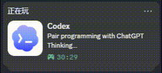

# Discord Codex Presence

**在 Discord 上显示你正在玩 Codex。**

**Show _Playing Codex_ on Discord while you work in the ChatGPT / Codex desktop app.**

[中文](#中文) | [English](#english)



`Windows-first` · `Discord Stable & PTB` · `No bot token` · `No OAuth` · `No public server`

---

## 中文

### 这是什么

Discord Codex Presence 是一个本地 ChatGPT / Codex 桌面插件。它通过 Discord 桌面客户端的本地 IPC 连接发布 Rich Presence，让你的个人资料显示：

> **正在玩 Codex**
> **Pair programming with ChatGPT**
> **Thinking…**

它只修改你自己的 Discord 活动状态，不读取其他人的资料，也不需要 Discord 机器人、Bot Token、OAuth 授权或公网服务器。

### 功能

- 显示 `Playing Codex`，应用图标来自你自己的 Discord Application。
- 第一行默认显示 `Pair programming with ChatGPT`。
- 第二行实时显示当前阶段：`Thinking…`、`Answering…`、`Running a command…`、`Editing a file…`、`Using the computer…`、`Searching the web…`、`Using a tool…`、`Idle`。
- 在 Windows 上跟随当前打开的对话：切换对话后，副标题会切换到对应会话的实时状态。
- 退出 ChatGPT / Codex 桌面端后约 3–5 秒自动清除活动，避免残留“正在玩”。
- 支持 Discord 稳定版和 Discord PTB。
- 提供 MCP 工具，可手动设置、检查或清除活动。
- 附带隐藏启动项，登录 Windows 后自动运行实时状态监控器。

### 工作方式

```text
ChatGPT / Codex 桌面端
        │ MCP over stdio
        ▼
本地 Node.js 服务
        │ Discord IPC
        ▼
Discord 桌面客户端  →  Discord 个人资料中的 Playing 活动
```

实时状态监控器只在 Windows 上读取 ChatGPT 主窗口当前显示的对话标题，并将其映射到 `%USERPROFILE%\.codex\state_5.sqlite` 中的会话记录。随后它只监听该会话对应 JSONL 文件中的事件类型，用来判断“思考 / 回答 / 执行命令 / 编辑文件”等阶段。

如果窗口标题暂时不可用，会回退到 `%USERPROFILE%\.codex\logs_2.sqlite` 中的 `thread/resume` / `thread/start` 事件。提示词和回答内容不会被上传到任何地方；插件只在本机读取事件类型，并向 Discord 发送固定的状态文案。

### 环境要求

| 项目 | 要求 |
| --- | --- |
| 操作系统 | Windows 10/11（完整实时状态与自动跟随对话目前仅支持 Windows） |
| Node.js | **22.5 或更高版本**，因为使用内置的 `node:sqlite` |
| ChatGPT | ChatGPT / Codex 桌面端，且会话在本机执行 |
| Discord | Discord 桌面客户端（稳定版或 PTB），已登录 |
| Discord 设置 | 开启 `Activity Privacy` → `Display current activity as a status message` |
| Discord Application | 一个 Application ID；不需要 Bot，也不需要 Token |

macOS / Linux 可以使用核心 Rich Presence 功能，但当前安装脚本和“跟随当前对话”的窗口读取逻辑面向 Windows。

### 快速开始

#### 1. 获取代码

```powershell
git clone https://github.com/zhushao233/codex-discord-presence.git
cd codex-discord-presence
```

#### 2. 创建 Discord Application

1. 打开 <https://discord.com/developers/applications>。
2. 点击 `New Application`。
3. 将应用命名为 `Codex`。Discord 会显示 `Playing` + 应用名，所以这个名字决定最终文案。
4. 在 `General Information` 中复制 `Application ID`。它是 15–25 位数字，属于公开标识，不是密码。
5. 可选：在同一个页面把 `assets/icon.png` 上传为应用图标。Discord 活动旁会显示这个图标。

> 如果你把 Discord Application 命名为别的名字，状态就会变成 `Playing <那个名字>`，而不是 `Playing Codex`。

#### 3. 安装插件

在仓库目录运行：

```powershell
powershell -ExecutionPolicy Bypass -File .\install.ps1 -ClientId <你的_Application_ID>
```

例如：

```powershell
powershell -ExecutionPolicy Bypass -File .\install.ps1 -ClientId 123456789012345678
```

安装脚本会：

- 把插件复制到 `%USERPROFILE%\.codex\plugins\codex-discord-presence`；
- 将 Discord Application ID 保存到 `%USERPROFILE%\.codex-discord-presence\config.json`；
- 在 `%USERPROFILE%\.agents\plugins\marketplace.json` 注册个人插件市场；
- 在 Windows 启动目录写入隐藏启动项 `CodexDiscordPresence.vbs`；
- 启动实时状态监控器；如已有实例在运行，新实例会自动退出，不会重复连接。

可选参数：

```powershell
# 自定义 Discord 应用名
.\install.ps1 -ClientId 123456789012345678 -ApplicationName Codex

# 只安装，不写配置，稍后通过插件工具配置
.\install.ps1 -SkipConfig

# 不安装开机启动项
.\install.ps1 -ClientId 123456789012345678 -SkipStartup
```

#### 4. 在 ChatGPT 桌面端启用

1. 完全退出并重新打开 ChatGPT / Codex 桌面端。
2. 打开 **Plugins Directory**，进入 **Personal Plugins / 个人插件**。
3. 安装 **Discord Codex Presence**。
4. 新建对话，在输入框输入 `@`，选择该插件。
5. 发送：

```text
把 Discord 状态改成正在玩 Codex
```

插件会检查本地配置和 Discord IPC 连接，然后设置活动。成功后，Discord 个人资料会显示 `Playing Codex`。

#### 5. 检查状态

保持 Discord 桌面端打开，然后在仓库或安装目录运行：

```powershell
node server/index.js --status
```

实时状态日志：

```powershell
Get-Content "$env:USERPROFILE\.codex-discord-presence\live.log" -Tail 40
```

### 实时状态

安装脚本默认会在 Windows 登录时启动 `server/live-presence.js`。它会：

- 只使用一个 Discord IPC 连接，持续更新副标题；
- 在切换对话后跟随新的当前会话；
- 在没有活动回合时显示 `Idle`；
- 在 ChatGPT / Codex 主窗口退出后清除 Discord 活动；
- 在 Discord PTB 重建本地管道时自动重连。

手动启动监控器：

```powershell
$plugin = "$env:USERPROFILE\.codex\plugins\codex-discord-presence"
Start-Process -FilePath (Get-Command node).Source `
  -ArgumentList "`"$plugin\server\live-presence.js`"" `
  -WindowStyle Hidden
```

停止监控器：

```powershell
New-Item -ItemType File -Force "$env:USERPROFILE\.codex-discord-presence\live.stop" | Out-Null
```

运行时文件位于 `%USERPROFILE%\.codex-discord-presence\`：

| 文件 | 用途 |
| --- | --- |
| `live.log` | 状态切换、当前对话和连接日志；超过 256 KB 自动清空 |
| `live.pid` | 当前监控器进程号 |
| `live.stop` | 创建该文件后，监控器会在下一次轮询时退出并清除活动 |
| `config.json` | Discord Application ID 与应用名 |

> Discord 对同一个 Application ID 通常只接受一个活动的 IPC 连接。如果 MCP 工具和实时监控器同时连接，可能出现状态互相覆盖。正常情况下让监控器持有连接，并使用插件工具检查或清除状态即可。

### 手动配置

不运行安装脚本时，可以手动创建：

`%USERPROFILE%\.codex-discord-presence\config.json`

```json
{
  "clientId": "123456789012345678",
  "applicationName": "Codex"
}
```

也支持环境变量覆盖：

```powershell
$env:DISCORD_CLIENT_ID = "123456789012345678"
$env:DISCORD_APPLICATION_NAME = "Codex"
```

自定义配置路径：

```powershell
$env:CODEX_DISCORD_PRESENCE_CONFIG = "D:\config\discord-presence.json"
```

### 插件工具

| 工具 | 作用 |
| --- | --- |
| `show_codex_activity` | 设置或更新活动，可自定义两行文案并保留计时器 |
| `get_discord_presence_status` | 检查本地配置、Discord IPC 连接和当前活动 |
| `configure_discord_app` | 保存 Discord Application ID 和应用名 |
| `clear_discord_activity` | 清除 Discord 活动 |

### 命令行

```powershell
node server/index.js --status
node server/index.js --show "Pair programming with ChatGPT" "Building with Codex"
node server/index.js --clear
node server/index.js --set-client-id 123456789012345678 Codex
node server/index.js --print-config
```

### 故障排查

| 现象 | 处理 |
| --- | --- |
| Discord 没有显示状态 | 确认使用的是 Discord 桌面客户端而不是网页版；确认已登录；确认应用 ID 已配置；在 Discord 设置中开启活动隐私。 |
| `DISCORD_NOT_CONFIGURED` | 运行 `node server/index.js --set-client-id <ID> Codex`，或在插件中调用 `configure_discord_app`。 |
| `DISCORD_NOT_RUNNING` | 启动 Discord 桌面客户端并登录。PTB 刚启动时可以等待几秒，监控器会自动重试。 |
| 显示了 `Playing`，但没有副标题 | 检查监控器是否在运行：`Get-Content "$env:USERPROFILE\.codex-discord-presence\live.pid"`；查看 `live.log`。 |
| 退出 ChatGPT 后状态还在 | 确认运行的是当前版本；等待 3–5 秒；必要时创建 `live.stop` 后重新启动监控器。 |
| 切换对话后状态不对 | 当前对话标题需要能匹配 `state_5.sqlite` 中的会话名；查看 `live.log` 中的 `UI selected` 或 `UI title unmatched`。 |
| 应用名显示错误 | 在 Discord Developer Portal 修改 Application 名称，然后完全退出并重新打开 Discord 以刷新缓存。 |
| 安装后插件不出现 | 重启 ChatGPT 桌面端，并检查 `%USERPROFILE%\.agents\plugins\marketplace.json`。 |
| PowerShell 找不到 `node` | 重新打开终端；安装脚本会优先使用 `%LOCALAPPDATA%\Programs\nodejs\node.exe`。 |

清除卡住的状态：

```powershell
node server/index.js --clear
```

### 限制与隐私

- 仅适用于本机运行的 ChatGPT / Codex 桌面端会话；网页版和手机端无法访问本机 Discord IPC。
- 只能设置 Rich Presence，不能设置 Discord 的自由文本“自定义状态”。
- 无法读取其他用户的 Discord 活动。
- 实时状态依赖本机监控器进程；关闭 Discord 或 ChatGPT 后活动会消失。
- 同一个 Discord Application ID 同一时间只应有一个 IPC 客户端占用。
- 不需要也不应提供 Discord 密码、MFA 验证码或 Bot Token。
- 插件不会把提示词、回答或会话内容发送到第三方服务；只在本机读取事件类型并发送固定状态文案到 Discord。

### 卸载

```powershell
# 停止监控器
New-Item -ItemType File -Force "$env:USERPROFILE\.codex-discord-presence\live.stop" | Out-Null

# 删除隐藏启动项
Remove-Item "$env:APPDATA\Microsoft\Windows\Start Menu\Programs\Startup\CodexDiscordPresence.vbs" -ErrorAction SilentlyContinue

# 删除插件与本地配置
Remove-Item "$env:USERPROFILE\.codex\plugins\codex-discord-presence" -Recurse -Force -ErrorAction SilentlyContinue
Remove-Item "$env:USERPROFILE\.codex-discord-presence" -Recurse -Force -ErrorAction SilentlyContinue
```

最后可在 `%USERPROFILE%\.agents\plugins\marketplace.json` 中移除 `codex-discord-presence` 条目。

### 开发与测试

```powershell
node --check .\server\live-presence.js
node --test
```

项目结构：

```text
.codex-plugin/          ChatGPT / Codex 插件清单
server/                 MCP 服务、Discord IPC、实时状态监控器
skills/                 插件技能说明
assets/                 图标与演示 GIF
test/                   单元测试与集成测试
install.ps1             Windows 安装脚本
```

---

## English

### What is this?

Discord Codex Presence is a local plugin for the ChatGPT / Codex desktop app. It publishes Rich Presence through the Discord desktop client's local IPC connection, so your profile can show:

> **Playing Codex**
> **Pair programming with ChatGPT**
> **Thinking…**

It only changes your own Discord activity. It does not read other users' profiles and does not need a Discord bot, bot token, OAuth authorization, or a public server.

### Features

- Shows `Playing Codex`, with the icon from your own Discord Application.
- The first line defaults to `Pair programming with ChatGPT`.
- The second line updates in real time: `Thinking…`, `Answering…`, `Running a command…`, `Editing a file…`, `Using the computer…`, `Searching the web…`, `Using a tool…`, or `Idle`.
- On Windows, follows the currently open conversation and switches the subtitle with it.
- Clears the activity about 3–5 seconds after the ChatGPT / Codex desktop app exits.
- Works with Discord Stable and Discord PTB.
- Includes MCP tools for manual show, status, and clear operations.
- Installs a hidden Windows startup entry so the live watcher starts after login.

### How it works

```text
ChatGPT / Codex desktop app
        │ MCP over stdio
        ▼
Local Node.js service
        │ Discord IPC
        ▼
Discord desktop client  →  Playing activity on your Discord profile
```

On Windows, the live watcher reads the active conversation title from the main ChatGPT window and maps it to a thread in `%USERPROFILE%\.codex\state_5.sqlite`. It then watches only event types in that thread's JSONL session file to determine phases such as thinking, answering, running a command, or editing a file.

If the window title is temporarily unavailable, it falls back to `thread/resume` and `thread/start` events in `%USERPROFILE%\.codex\logs_2.sqlite`. Prompts and answers are not uploaded anywhere; the plugin only reads event types locally and sends fixed status text to Discord.

### Requirements

| Item | Requirement |
| --- | --- |
| OS | Windows 10/11 for the full live state and active-conversation tracking |
| Node.js | **22.5 or newer**, because the watcher uses the built-in `node:sqlite` |
| ChatGPT | ChatGPT / Codex desktop app with local sessions |
| Discord | Discord desktop client (Stable or PTB), signed in |
| Discord settings | `Activity Privacy` → `Display current activity as a status message` |
| Discord Application | One Application ID; no bot or token is required |

The core Rich Presence feature can run on macOS / Linux, but the current installer and active-conversation title integration are Windows-specific.

### Quick start

#### 1. Clone the repository

```powershell
git clone https://github.com/zhushao233/codex-discord-presence.git
cd codex-discord-presence
```

#### 2. Create a Discord Application

1. Open <https://discord.com/developers/applications>.
2. Click `New Application`.
3. Name it `Codex`. Discord displays `Playing` plus the application name, so this name controls the final label.
4. Copy the `Application ID` from `General Information`. It is a 15–25 digit public identifier, not a password.
5. Optional: upload `assets/icon.png` as the application icon on the same page. Discord shows this icon next to the activity.

> If you name the Discord Application something else, Discord will show `Playing <that name>` instead of `Playing Codex`.

#### 3. Install the plugin

Run this from the repository directory:

```powershell
powershell -ExecutionPolicy Bypass -File .\install.ps1 -ClientId <YOUR_APPLICATION_ID>
```

For example:

```powershell
powershell -ExecutionPolicy Bypass -File .\install.ps1 -ClientId 123456789012345678
```

The installer will:

- copy the plugin to `%USERPROFILE%\.codex\plugins\codex-discord-presence`;
- save the Discord Application ID to `%USERPROFILE%\.codex-discord-presence\config.json`;
- register the personal plugin marketplace in `%USERPROFILE%\.agents\plugins\marketplace.json`;
- install a hidden startup entry named `CodexDiscordPresence.vbs` on Windows;
- start the live watcher. If an instance is already running, the new one exits without opening a second IPC connection.

Optional flags:

```powershell
# Use a custom Discord application name
.\install.ps1 -ClientId 123456789012345678 -ApplicationName Codex

# Install only; configure the application ID later through the plugin tools
.\install.ps1 -SkipConfig

# Do not install the startup entry
.\install.ps1 -ClientId 123456789012345678 -SkipStartup
```

#### 4. Enable it in ChatGPT

1. Fully quit and reopen the ChatGPT / Codex desktop app.
2. Open **Plugins Directory**, then **Personal Plugins**.
3. Install **Discord Codex Presence**.
4. Start a new chat, type `@`, and select the plugin.
5. Send:

```text
把 Discord 状态改成正在玩 Codex
```

The plugin checks the local configuration and Discord IPC connection, then sets the activity. Once successful, your Discord profile shows `Playing Codex`.

#### 5. Check the status

Keep the Discord desktop client open, then run this from the repository or installed plugin directory:

```powershell
node server/index.js --status
```

Live watcher log:

```powershell
Get-Content "$env:USERPROFILE\.codex-discord-presence\live.log" -Tail 40
```

### Live status

By default, the Windows installer starts `server/live-presence.js` at login. It:

- keeps a single Discord IPC connection and updates the subtitle continuously;
- follows the newly selected conversation after you switch chats;
- shows `Idle` when no turn is active;
- clears the Discord activity after the main ChatGPT / Codex window exits;
- reconnects automatically when Discord PTB recreates its local pipe.

Start the watcher manually:

```powershell
$plugin = "$env:USERPROFILE\.codex\plugins\codex-discord-presence"
Start-Process -FilePath (Get-Command node).Source `
  -ArgumentList "`"$plugin\server\live-presence.js`"" `
  -WindowStyle Hidden
```

Stop the watcher:

```powershell
New-Item -ItemType File -Force "$env:USERPROFILE\.codex-discord-presence\live.stop" | Out-Null
```

Runtime files live in `%USERPROFILE%\.codex-discord-presence\`:

| File | Purpose |
| --- | --- |
| `live.log` | State changes, selected conversations, and connection logs; reset after 256 KB |
| `live.pid` | PID of the current watcher |
| `live.stop` | Create this file to make the watcher exit and clear the activity |
| `config.json` | Discord Application ID and application name |

> Discord generally accepts one active IPC connection per Application ID. If an MCP tool call and the live watcher both connect, they can overwrite each other's activity. Normally, let the watcher own the connection and use the plugin tools only to inspect or clear the activity.

### Manual configuration

If you do not use the installer, create:

`%USERPROFILE%\.codex-discord-presence\config.json`

```json
{
  "clientId": "123456789012345678",
  "applicationName": "Codex"
}
```

Environment variables can override the file:

```powershell
$env:DISCORD_CLIENT_ID = "123456789012345678"
$env:DISCORD_APPLICATION_NAME = "Codex"
```

Use a custom config path:

```powershell
$env:CODEX_DISCORD_PRESENCE_CONFIG = "D:\config\discord-presence.json"
```

### Plugin tools

| Tool | Purpose |
| --- | --- |
| `show_codex_activity` | Set or update the activity, with optional custom lines and timer reset |
| `get_discord_presence_status` | Check local configuration, Discord IPC connection, and current activity |
| `configure_discord_app` | Save the Discord Application ID and application name |
| `clear_discord_activity` | Clear the Discord activity |

### CLI

```powershell
node server/index.js --status
node server/index.js --show "Pair programming with ChatGPT" "Building with Codex"
node server/index.js --clear
node server/index.js --set-client-id 123456789012345678 Codex
node server/index.js --print-config
```

### Troubleshooting

| Symptom | Fix |
| --- | --- |
| Discord shows no activity | Use the Discord desktop client, not the web app; sign in; verify the application ID; enable activity privacy in Discord. |
| `DISCORD_NOT_CONFIGURED` | Run `node server/index.js --set-client-id <ID> Codex`, or call `configure_discord_app` from the plugin. |
| `DISCORD_NOT_RUNNING` | Start and sign in to the Discord desktop client. After a PTB restart, wait a few seconds for the automatic retry. |
| `Playing` appears without a subtitle | Check that the watcher is running: `Get-Content "$env:USERPROFILE\.codex-discord-presence\live.pid"`; then inspect `live.log`. |
| Activity remains after ChatGPT exits | Confirm you are running the current version; wait 3–5 seconds; if needed, create `live.stop` and start the watcher again. |
| Wrong state after switching chats | The active title must match a thread name in `state_5.sqlite`; look for `UI selected` or `UI title unmatched` in `live.log`. |
| Wrong application name | Rename the application in the Discord Developer Portal, then fully restart Discord to refresh its cache. |
| Plugin does not appear after installation | Restart the ChatGPT desktop app and inspect `%USERPROFILE%\.agents\plugins\marketplace.json`. |
| PowerShell cannot find `node` | Reopen the terminal; the installer prefers `%LOCALAPPDATA%\Programs\nodejs\node.exe`. |

Clear a stuck activity:

```powershell
node server/index.js --clear
```

### Limitations and privacy

- Desktop only: local ChatGPT / Codex sessions only. The web app and mobile app cannot access local Discord IPC.
- Rich Presence only: this cannot set Discord's free-form custom status.
- It cannot read other Discord users' activity.
- Live status depends on the local watcher; closing Discord or ChatGPT makes the activity disappear.
- Only one IPC client should use a given Discord Application ID at a time.
- You never need to provide a Discord password, MFA code, or bot token.
- Prompts, answers, and conversation contents are not sent to any third party. The watcher reads event types locally and sends only fixed status text to Discord.

### Uninstall

```powershell
# Stop the watcher
New-Item -ItemType File -Force "$env:USERPROFILE\.codex-discord-presence\live.stop" | Out-Null

# Remove the hidden startup entry
Remove-Item "$env:APPDATA\Microsoft\Windows\Start Menu\Programs\Startup\CodexDiscordPresence.vbs" -ErrorAction SilentlyContinue

# Remove the plugin and local configuration
Remove-Item "$env:USERPROFILE\.codex\plugins\codex-discord-presence" -Recurse -Force -ErrorAction SilentlyContinue
Remove-Item "$env:USERPROFILE\.codex-discord-presence" -Recurse -Force -ErrorAction SilentlyContinue
```

You can also remove the `codex-discord-presence` entry from `%USERPROFILE%\.agents\plugins\marketplace.json`.

### Development and testing

```powershell
node --check .\server\live-presence.js
node --test
```

Project layout:

```text
.codex-plugin/          ChatGPT / Codex plugin manifest
server/                 MCP server, Discord IPC, and live watcher
skills/                 Plugin skill instructions
assets/                 Icons and demo GIF
test/                   Unit and integration tests
install.ps1             Windows installer
```

---

This is a local community plugin. It is not affiliated with OpenAI or Discord.
